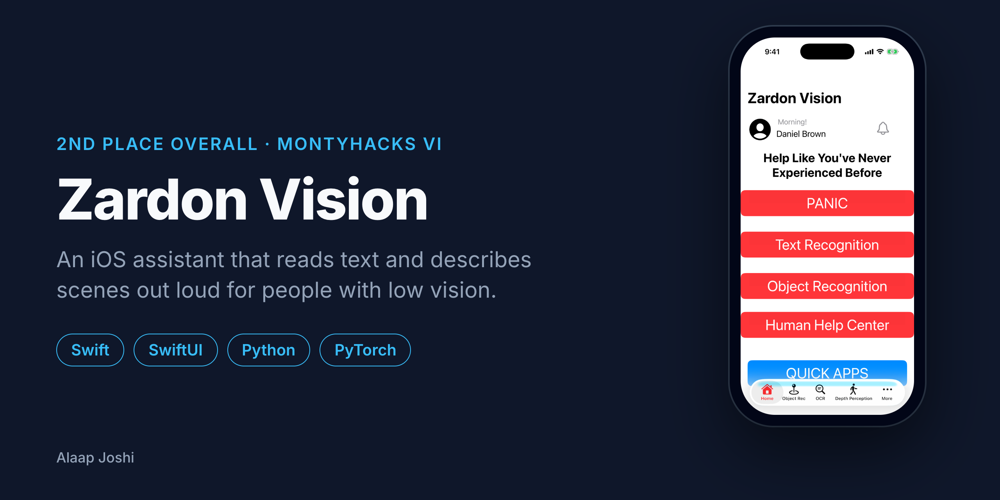
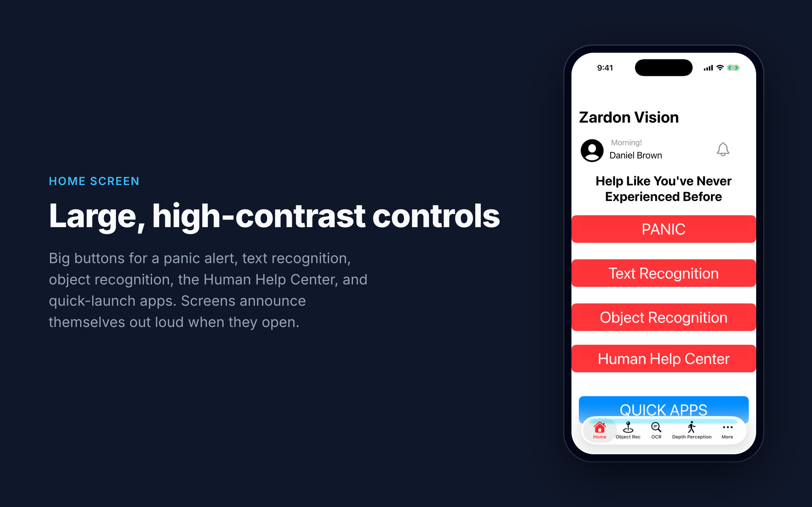
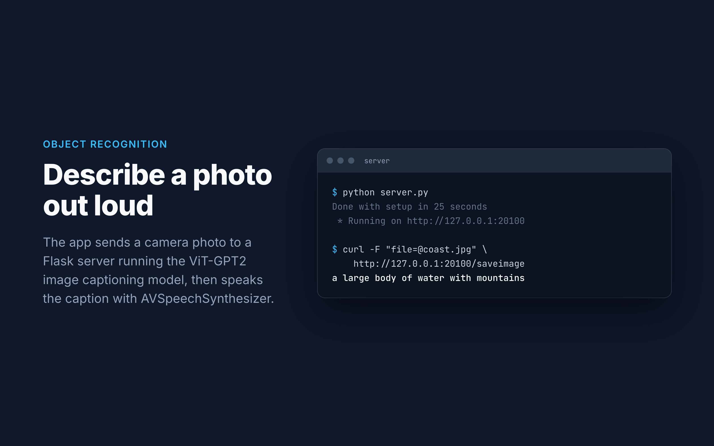
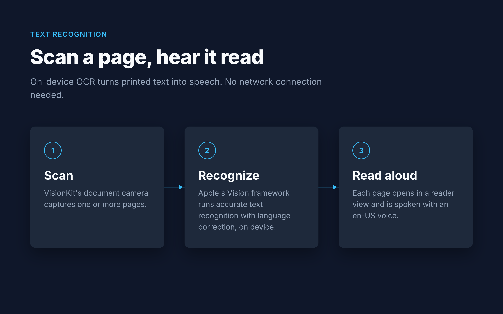
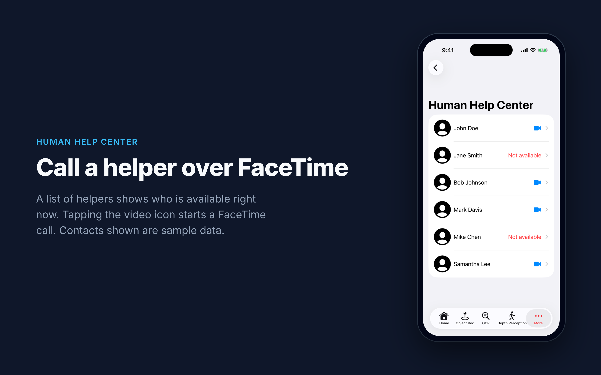
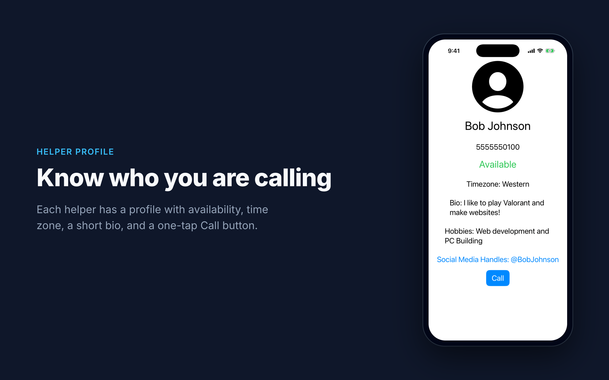
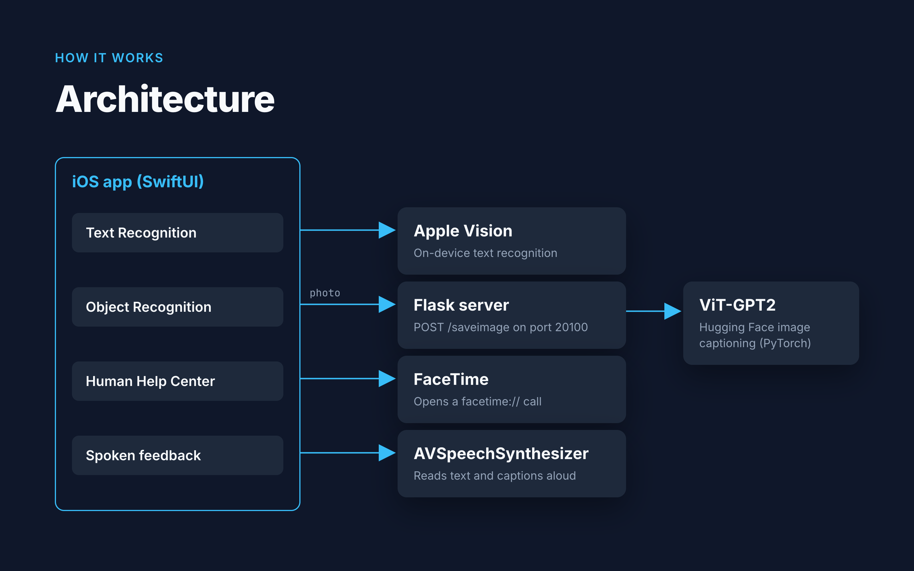

# Zardon Vision

> An iOS assistant that reads text and describes scenes out loud for people with low vision.

   

## About
People with low vision often need help with everyday tasks like reading a page or knowing what is in front of them. Zardon Vision puts those tools in one app with large, high-contrast controls and spoken feedback on every screen. It combines on-device text recognition with a Python server that runs a ViT-GPT2 image captioning model, so a photo becomes a spoken sentence. Built solo for MontyHacks VI, where it won 2nd place overall ([Devpost](https://devpost.com/software/zardon-visiono)).

## Features
- Reads printed text aloud by scanning pages with the document camera and running Apple's Vision text recognition on device.
- Describes a photo out loud by sending it to a Flask server running a Hugging Face image captioning model.
- Lets users FaceTime a helper from the Human Help Center, which shows who is available.
- Announces each screen with text-to-speech when it opens.
- Offers a panic button and quick-launch shortcuts to apps like Uber and Uber Eats from the home screen.

## Gallery
<table>
  <tr>
    <td width="50%"> Home screen with large, high-contrast controls</td>
    <td width="50%"> Real output from the captioning server</td>
  </tr>
  <tr>
    <td width="50%"> How text recognition works, fully on device</td>
    <td width="50%"> Human Help Center with sample helpers</td>
  </tr>
  <tr>
    <td width="50%"> Helper profile with a one-tap Call button</td>
    <td width="50%"> Architecture overview</td>
  </tr>
</table>

## Tech Stack
| Layer | Technology |
|---|---|
| Frontend | Swift, SwiftUI, Vision, VisionKit, AVFoundation (AVSpeechSynthesizer) |
| Backend | Python, Flask |
| ML | PyTorch, Hugging Face Transformers ([nlpconnect/vit-gpt2-image-captioning](https://huggingface.co/nlpconnect/vit-gpt2-image-captioning)) |
| Website | HTML, CSS |
| Tools | Xcode |

## Getting Started

### Prerequisites
- macOS with Xcode 14+
- An iPhone running iOS 15+ (the camera features need a real device, not the simulator)
- Python 3.9+ for the captioning server
- The iPhone and the computer running the server on the same Wi-Fi network

### Installation
~~~bash
git clone https://github.com/alaapjoshi/zardon-vision.git
cd zardon-vision/server
python3 -m venv .venv
source .venv/bin/activate
pip install -r requirements.txt
~~~

### Usage
1. Start the captioning server. The first run downloads the model (about 1 GB).
   ~~~bash
   python server.py
   ~~~
   When it prints `Running on http://<your-ip>:20100`, it is ready. You can test it without the app:
   ~~~bash
   curl -F "file=@photo.jpg" http://127.0.0.1:20100/saveimage
   # a large body of water with mountains
   ~~~
2. Open `ios/Zardon Vision.xcodeproj` in Xcode.
3. In `ios/Zardon Vision/Describe/CameraView.swift`, change the IP address in the server URL to your computer's local IP.
4. Pick your signing team under Signing & Capabilities, connect your iPhone, and press Run.
5. Turn your ringer on. Each screen speaks its name when it opens. Use the OCR tab to scan text, or the Object Rec tab to take a photo and hear a description.

The landing page is static. Open `website/index.html` in a browser to view it.

## Project Structure
~~~text
zardon-vision/
  ios/          # Xcode project and SwiftUI source for the iPhone app
  server/       # Flask server that captions photos with ViT-GPT2
  website/      # Static landing page (HTML/CSS)
  docs/images/  # README cover and gallery images, with HTML sources in src/
~~~

## How It Works
The app is a SwiftUI tab view with a screen for each tool. Text recognition stays on the phone: VisionKit's document camera captures pages, and a `VNRecognizeTextRequest` (accurate mode, with language correction) turns each page into text that `AVSpeechSynthesizer` reads aloud. Object recognition sends the photo as a multipart POST to the Flask server. The server runs the ViT encoder and GPT-2 decoder with beam search (4 beams, max 16 tokens) and returns a one-line caption, which the app speaks. The Human Help Center opens `facetime://` links to call a helper.

~~~mermaid
flowchart LR
    subgraph App[iOS app]
        OCR[Text Recognition]
        OBJ[Object Recognition]
        HELP[Human Help Center]
    end
    OCR -->|scanned pages| VISION[Apple Vision OCR]
    OBJ -->|POST /saveimage| FLASK[Flask server]
    FLASK --> MODEL[ViT-GPT2 captioning]
    MODEL -->|caption| FLASK
    FLASK -->|caption text| TTS[AVSpeechSynthesizer]
    VISION -->|recognized text| TTS
    HELP -->|facetime://| FT[FaceTime]
~~~

## Future Improvements
- Finish the facial recognition tab with a Create ML model that recognizes saved faces.
- Run image captioning on device with Core ML so the app works without a server.
- Make the server address a setting instead of a hard-coded IP.
- Connect the panic button to real alerts, such as texting emergency contacts.

## Author
**Alaap Joshi** - Computer Science + Cognitive Science, Rutgers University-New Brunswick
[GitHub](https://github.com/alaapjoshi) | [LinkedIn](https://linkedin.com/in/alaapjoshi)

## License
MIT. See [LICENSE](LICENSE).
